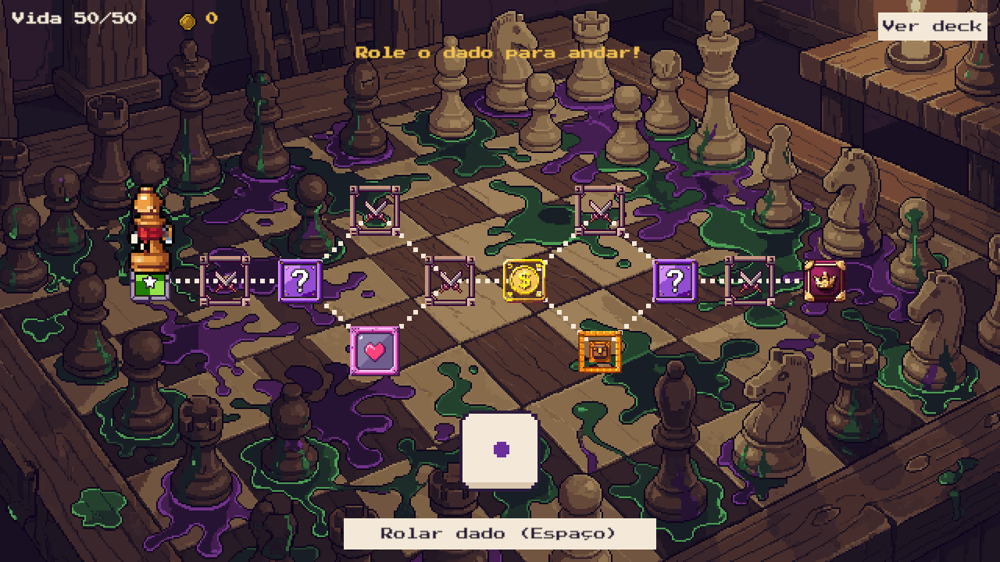

# Xeque de Tinta · 01 Planejamento

**Disciplina:** Desenvolvimento de Jogos · **Autores:** Márcio Dias de Lima Filho e Tiago Augusto Dal'Acqua Gonçalves · **Motor:** Unity 6 (6000.4) 2D com URP, C#.

## 1. Conceito

**Xeque de Tinta** é um **roguelite de tabuleiro com batalhas de cartas em turnos**. O jogador controla um peão de xadrez que atravessa um tabuleiro de 12 casas rolando um dado. Cada casa onde ele para pode ser uma batalha, uma loja, um descanso, um evento, um baú ou o chefe. As batalhas são duelos de cartas no estilo *Slay the Spire*: o jogador monta e melhora um baralho, lê as **intenções** dos inimigos e usa o **ciclo de elementos** (Fogo, Planta, Água) para causar mais dano.

| Item | Valor |
|---|---|
| Gênero | Roguelite de tabuleiro + batalha de cartas em turnos |
| Plataforma | PC: Windows e macOS |
| Visual | Pixel art 32x32 (chefe 64x64), câmera fixa, fundo roxo escuro, cores vivas |
| Duração | Uma fase, cerca de 9 a 15 minutos por partida |
| Controles | Mouse (atalhos: Espaço e Esc) |
| Referências | *Slay the Spire* (cartas e intenções), *Mario Party* (dado e casas) |

## 2. Narrativa

O jogo acontece sobre **um tabuleiro de xadrez gigante**, à luz de uma vela. **Tinta mágica** roxa e verde foi derramada sobre ele e "afogou" as peças, que viraram **slimes**. O **Rei Slime** é o próprio rei do xadrez tomado pela tinta, com a coroa afundada na gosma. O **Peão**, a peça mais fraca, é a única que sobrou e atravessa as casas para limpar o tabuleiro.

- **Abertura:** na primeira vez que o tabuleiro abre, uma caixa de 3 linhas conta a história e só então libera o dado. O título mostra a premissa: *"A tinta mágica afogou as peças. Só o peão pode salvar o tabuleiro."*
- **Personagens:** Peão (herói), Slime Verde (torre), Slime Vermelho (cavalo), Slime Azul (bispo), Slime Mirim (peão de tinta) e Rei Slime (chefe).
- **Final:** ao vencer o Rei Slime, a tinta seca, o peão comemora e aparece a tela de **Vitória** com os créditos.

## 3. Público-alvo

Jogadores casuais e de jogos de cartas e tabuleiro (a partir de 10 anos), que gostam de partidas curtas, de decisões táticas simples e de pixel art. O jogo ensina por si só: as intenções mostram o que vai acontecer, os elementos têm ícones, e o único atalho necessário é o mouse.

## 4. Jogabilidades, movimentações e habilidades implementadas

### 4.1 Movimentação (no tabuleiro)

O jogo não tem movimentação em tempo real: a movimentação é **por casas, guiada pelo dado**, e é a parte nova em relação a um jogo de cartas comum.

| # | Movimentação / jogabilidade | Descrição |
|---|---|---|
| M1 | Rolar o dado | Sorteia de 1 a 3 (configurável em `GameConfig`). Dado com animação de giro e número grande ao parar. |
| M2 | Andar casa a casa | O Peão **pula** de casa em casa (animação *hop*, passo sonoro). |
| M3 | Bifurcações | Duas bifurcações (casas 2 e 6). O jogador **escolhe o caminho** clicando na casa; setas douradas indicam as opções. |
| M4 | Parar só onde cai | Só a casa onde o Peão **para** é resolvida; as de passagem não. |
| M5 | Parada obrigatória no Chefe | Ao passar pela casa do Rei Slime, o Peão **para nela** mesmo sobrando passos. |
| M6 | Casas resolvidas ficam cinzas | Parar numa casa cinza não faz nada. |
| M7 | Dado Viciado | A relíquia permite **rolar de novo**; botões "Andar" e "Rolar de novo". |

### 4.2 Batalha e jogabilidades

| # | Jogabilidade | Descrição |
|---|---|---|
| J1 | Turnos com energia | 3 de energia por turno, 5 cartas na mão; cartas custam 1 ou 2. |
| J2 | Deck, descarte e reembaralho | Compra, descarte e reembaralho automático quando o baralho acaba. Carta **Esgotar** sai da batalha. |
| J3 | Alvo por clique | Carta de alvo único pede clique no inimigo; cartas em área e de si mesmo agem direto. Esc ou botão direito cancelam. |
| J4 | Intenções dos inimigos | Ícone sobre cada inimigo mostra o que ele fará (Ataque com número, Defesa, Buff, Debuff, Invocar). |
| J5 | Ciclo de elementos | Fogo > Planta > Água > Fogo. Ataque eficaz: **+50%** e texto "Eficaz!". |
| J6 | Escudo | Absorve dano; zera no início do turno do dono. |
| J7 | Status | Queimadura, Fraco, Força, Atordoado (seção 4.4). |
| J8 | Recompensa e progressão do deck | Após cada batalha: 10 a 15 moedas e 1 carta entre 3. Melhoria de cartas no Descanso. |
| J9 | Loja | 3 cartas (50), 1 relíquia (100), cura de 15 (35), remover carta (60). |
| J10 | Eventos | 3 eventos com escolha e risco (Poça de Tinta, Dado Gigante, Fonte de Feltro). |
| J11 | Relíquias | 5 relíquias permanentes (seção 4.5). |
| J12 | Chefe em fases | Rei Slime com ciclo de 3 ações, invocação de Mirins e **fúria** abaixo de 50% de vida. |
| J13 | Pausa e volume | Esc pausa; controle de volume no título. |

### 4.3 Habilidades (cartas)

12 cartas, com **ataques**, **skills de defesa**, **cura**, **estados** e **ataque em área**:

| Carta | Custo | Elem. | Habilidade |
|---|---|---|---|
| Golpe | 1 | Neutro | Ataque: 6 de dano |
| Defender | 1 | Neutro | Skill: 5 de escudo |
| Investida | 2 | Neutro | Ataque + **Atordoar**: 10 de dano; o alvo perde a ação |
| Bola de Fogo | 1 | Fogo | Ataque: 7 de dano |
| Brasa | 1 | Fogo | Skill: **Queimadura 3** (2 de vida por turno, ignora escudo) |
| Raiz | 1 | Planta | Ataque + defesa: 4 de dano e 4 de escudo |
| Casca Grossa | 1 | Planta | Skill: 8 de escudo |
| Onda | 2 | Água | Ataque em **área**: 5 de dano em todos |
| Respingo | 1 | Água | Ataque + **Fraco 1** (−25% de dano) |
| Golpe Duplo | 1 | Neutro | Ataque: 4 de dano **duas vezes** |
| Seiva | 1 | Planta | Skill: **cura 6**, Esgota |
| Golpe Pesado | 2 | Neutro | Ataque: 14 de dano |

Cada carta tem versão **melhorada** (por exemplo, Golpe 6 → 9). Os detalhes estão no **Manual do Jogo** (documento 03).

### 4.4 Status

| Status | Efeito |
|---|---|
| Escudo | Absorve dano; zera no início do turno do dono |
| Queimadura (N) | No início do turno, perde 2 de vida (ignora escudo); dura N turnos; reaplicar soma turnos |
| Fraco (N) | −25% de dano por N turnos |
| Força (N) | +N de dano em cada ataque até o fim da batalha |
| Atordoado | Pula a próxima ação; a intenção fica para o turno seguinte |

### 4.5 Relíquias

Dado Viciado (rola de novo), Base de Chumbo (5 de escudo no início), Tinta Seca (cura 3 ao matar), Pincel Afiado (1 de Força no início), Ampulheta de Bolso (+1 de energia no primeiro turno).

### 4.6 Inimigos e habilidades deles

| Inimigo | Elem. | Vida | Habilidades |
|---|---|---|---|
| Slime Verde | Planta | 18 | Investida (5 de dano) ou Casca (4 de escudo), sorteio sem repetir escudo |
| Slime Vermelho | Fogo | 14 | Investida (7); a cada 3 turnos, Chama (Queimadura 2 no herói) |
| Slime Azul | Água | 22 | Respingo: 4 de dano e **cura 3** do aliado mais ferido |
| Slime Mirim | Planta | 8 | Cutucada (3 de dano) |
| Rei Slime | Planta | 70 | Ciclo: Esmagar (12) → **Dividir** (invoca 2 Mirins) → Coroa Pesada (8 de escudo e 6 de dano); **fúria** (+2 de Força) abaixo de 50% |

## 5. Método de vitória e de derrota

- **Vitória da partida:** derrotar o **Rei Slime**, na última casa do tabuleiro. O Peão só chega lá percorrendo o mapa e resolvendo as casas em que para. Aparece a tela *Vitória!*, com história e créditos.
- **Vitória na batalha:** todos os inimigos chegam a 0 de vida. Dá moedas e uma carta à escolha.
- **Derrota:** a vida do Peão chega a **0** em **qualquer batalha** (inclusive contra o Chefe). Aparece a tela *Derrota*, com **Tentar de novo** e **Voltar ao título**. Não há save nem progressão entre partidas: cada partida recomeça do zero.
- **Eventos nunca matam:** a perda de vida em eventos deixa no mínimo 1 de vida.

## 6. Escopo e cronograma (marcos)

Desenvolvimento em marcos, cada um com testes, screenshot e commit:

| Marco | Entrega |
|---|---|
| M0 | Base do projeto, Pixel Perfect Camera, lote 1 de arte, cena de teste |
| M1 | ScriptableObjects e assets de dados (12 cartas, 5 inimigos, 6 encontros, 5 relíquias, 3 eventos, 1 tabuleiro) |
| M2 | Tabuleiro: casas, dado, movimento, bifurcações, parada no Chefe |
| M3 | Batalha: máquina de estados, cartas, dano, elementos, status, IA, intenções |
| M4 | Partida: GameManager, RunState, troca de cenas, recompensas |
| M5 | Loja, Descanso, Evento, Baú, relíquias |
| M6 | Chefe, telas (Título, Pausa, Vitória, Derrota), lote 2 de arte |
| M7 | Áudio, números de dano, tremor de tela, transições |
| M8 | Playtest automático, balanceamento, builds |
| Pós-M8 | Correção do dado e do layout; **mudança de tema** para o tabuleiro de xadrez manchado de tinta |

Fora do escopo (ideias guardadas): mais fases, outros heróis, save, elite Slime Tinteiro.
