# Manual do Jogo · Xeque de Tinta

Um roguelite de tabuleiro com batalhas de cartas em turnos. Role o dado, ande pelas casas, monte seu baralho e limpe o tabuleiro do Rei Slime.

PC (Windows e Mac) · 1 jogador · mouse · partida de 10 a 15 minutos · Autores: Márcio Dias de Lima Filho e Tiago Augusto Dal'Acqua Gonçalves

## 1. A história

Num salão antigo, à luz de uma vela, existe um **tabuleiro de xadrez gigante**. Certa noite, alguém derramou sobre ele uma **tinta mágica roxa e verde**. A tinta escorreu pelas casas e "afogou" as peças: torres, cavalos e bispos viraram **slimes**, e o próprio rei do xadrez virou o **Rei Slime**, com a coroa afundada na gosma.

Só uma peça escapou: o **Peão**, a peça mais fraca do jogo. Sem poder nenhum, só com uma espadinha de ferro, um cachecol vermelho e muita teimosia, ele precisa atravessar o tabuleiro manchado, casa por casa, até enfrentar o Rei Slime e **secar a tinta de vez**.

A tinta mágica afogou as peças. Só o peão pode salvar o tabuleiro.

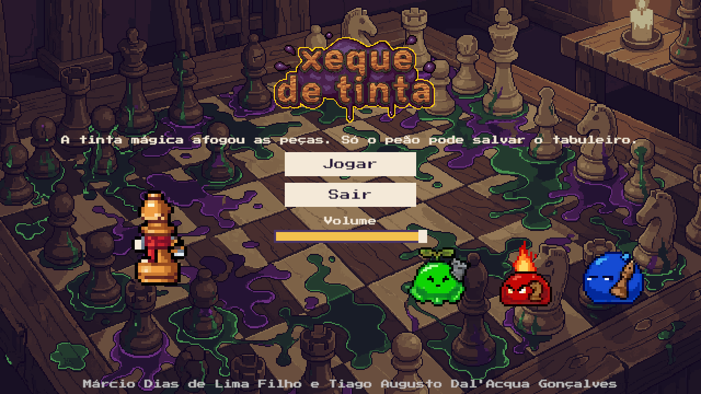

## 2. O herói: o Peão

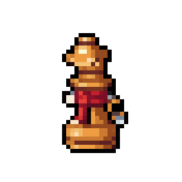

| | |
|---|---|
| **Vida** | 50 |
| **Elemento** | Neutro (os elementos vêm das cartas que ele joga) |
| **Energia** | 3 por turno |
| **Mão** | 5 cartas por turno |
| **Deck inicial** | 5 Golpe, 4 Defender e 1 Investida |

O Peão anda pelo tabuleiro (pulinhos de casa em casa), ataca com a espada na batalha, recua quando apanha e tomba quando cai. Sua força cresce com as **cartas** que você ganha, compra e melhora durante a partida e com as **relíquias** que encontra.

## 3. Os inimigos

Cada slime carrega, afundada na gosma, uma peça de xadrez e um detalhe do seu elemento (folha, chama ou gota). Acima da cabeça de cada inimigo aparece a **intenção**: o que ele vai fazer no próximo turno, com o número do dano quando for um ataque. Use isso para decidir entre atacar e se defender.

### Slime Verde · a torre

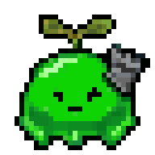

**Vida 18 · Elemento Planta.** Carrega uma torre cinza afundada no flanco. A cada turno **sorteia**: ataca com **Investida (5 de dano)** ou ganha **4 de escudo** com Casca. Nunca faz escudo duas vezes seguidas. *Fraco contra Fogo.*

### Slime Vermelho · o cavalo

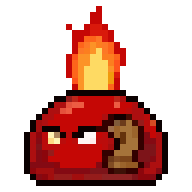

**Vida 14 · Elemento Fogo.** Tem uma chama no topo e uma cabeça de cavalo de madeira afundada no corpo. Ataca com **Investida (7 de dano)**. A cada **3 turnos**, em vez de atacar, solta **Chama** e aplica **Queimadura 2** em você. *Fraco contra Água.*

### Slime Azul · o bispo

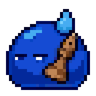

**Vida 22 · Elemento Água.** Tem uma gota no topo e o bispo de mitra pontuda afundado. Todo turno usa **Respingo: 4 de dano e cura 3 de vida** do aliado mais ferido (ou dele mesmo, se estiver sozinho). É o mais resistente dos três. *Fraco contra Planta.*

### Slime Mirim · o peão de tinta

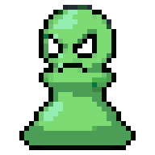

**Vida 8 · Elemento Planta.** Um pequeno peão de xadrez derretendo, com rostinho. Só aparece quando o Rei Slime o invoca. Ataca com **Cutucada: 3 de dano**. Um Mirim recém-invocado só age no turno seguinte. *Fraco contra Fogo.*

### O Chefe: Rei Slime

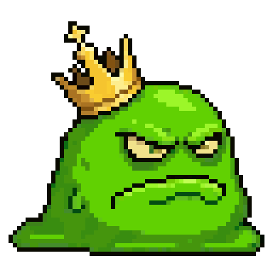

**Vida 70 · Elemento Planta · tamanho duplo (64 px).** O rei do xadrez tomado pela tinta, com a coroa de rei (com a cruz) afundada na gosma. Ele repete um **ciclo de três ações**:

1. **Esmagar:** 12 de dano.
2. **Dividir:** invoca **2 Slimes Mirins** (no máximo 2 vivos ao mesmo tempo).
3. **Coroa Pesada:** ganha 8 de escudo e causa 6 de dano.

Quando a vida cai **abaixo de 50%**, ele se enfurece e ganha **2 de Força** (uma vez só): todos os ataques dele passam a bater mais forte. *Fraco contra Fogo.*

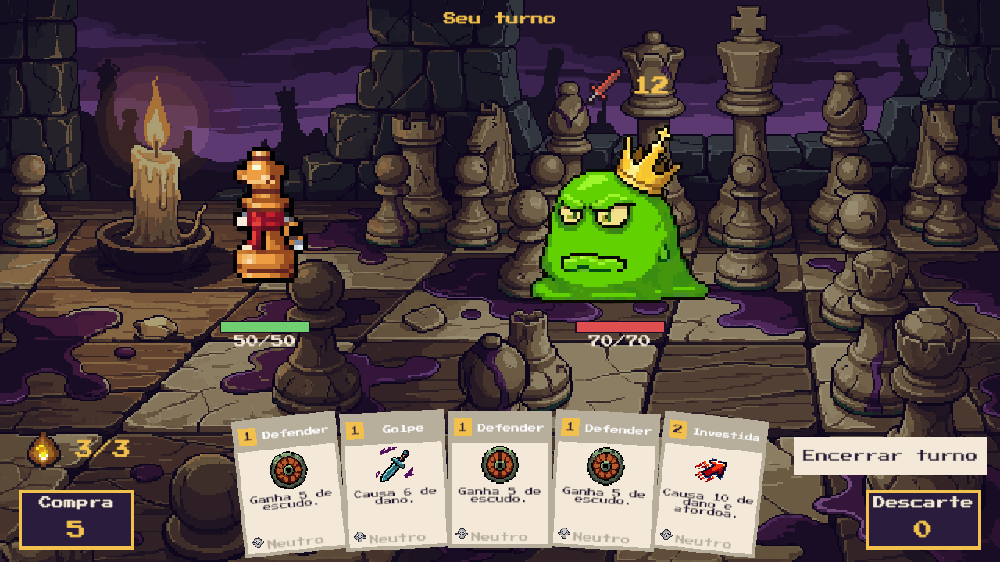

## 4. Comandos

O jogo é todo controlado pelo **mouse**. Há dois atalhos de teclado.

| Ação | Como fazer |
|---|---|
| Rolar o dado e andar | Clique em **Rolar dado** ou aperte **Espaço** |
| Escolher o caminho numa bifurcação | Clique na casa para onde quer ir (a seta dourada indica as opções) |
| Ver seu baralho | Botão **Ver deck**, no tabuleiro |
| Jogar uma carta | Clique na carta da mão. Se ela precisar de alvo, clique no inimigo |
| Cancelar a escolha de alvo | **Esc** ou botão direito do mouse |
| Encerrar o turno | Botão **Encerrar turno** ou **Espaço** |
| Pausar | **Esc** (menu: Continuar, Voltar ao título) |
| Ajustar o volume | Controle deslizante na tela de título |
| Comprar, escolher, confirmar | Clique nos botões dos painéis |

## 5. Como jogar uma partida

1. **Título.** Clique em **Jogar**. Uma caixa conta a história e, ao clicar em **Começar**, o dado é liberado.
2. **Tabuleiro.** O mapa de 12 casas está sempre visível. Role o dado (de 1 a 3) e o Peão anda essa quantidade de casas. Só a casa onde ele **para** acontece. Nas duas **bifurcações** você escolhe o caminho clicando. Se o Peão passa pela casa do **Chefe**, ele **para ali**.
3. **Casa resolvida.** Depois de resolvida, a casa fica **cinza**; parar nela de novo não faz nada.
4. **Batalha.** Ao parar numa casa de Batalha, a cena muda para o duelo (veja a seção 6).
5. **Recompensa.** Vencida a batalha, você ganha de **10 a 15 moedas** e escolhe **1 entre 3 cartas** novas (ou pula).
6. **Repita** até o **Rei Slime**. Vença-o para ganhar o jogo.

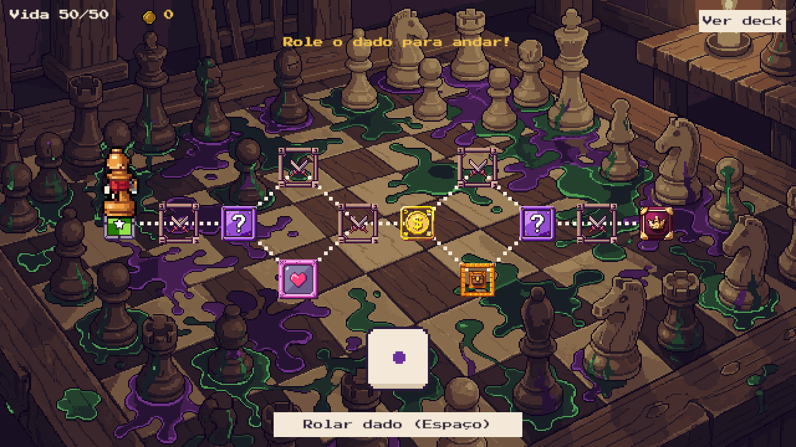

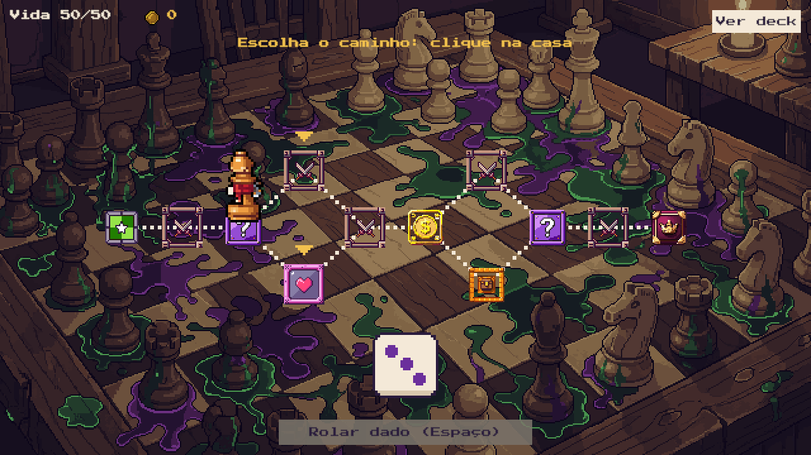

### A batalha

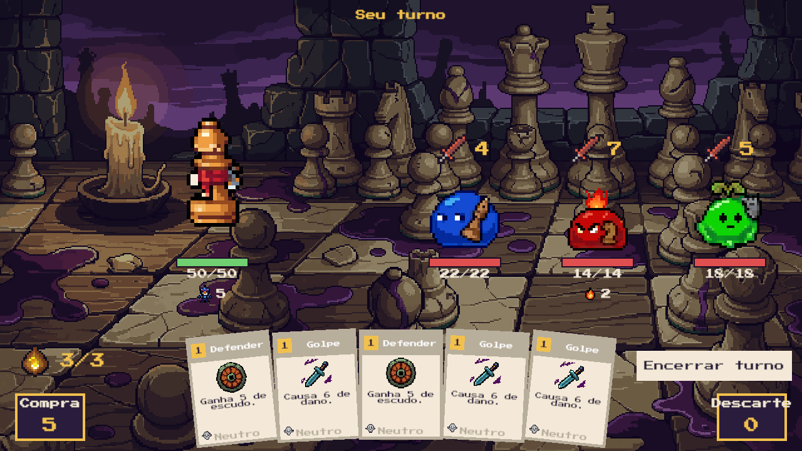

Você fica à esquerda; até 3 inimigos ficam à direita. A cada turno seu:

- seu **escudo** zera, você recebe **3 de energia** e compra **5 cartas**;
- cada carta gasta a energia indicada no canto superior esquerdo (o número dourado);
- jogue quantas cartas conseguir pagar e clique em **Encerrar turno**;
- as cartas que sobraram na mão vão para o **descarte**; quando o **baralho de compra** acaba, o descarte é embaralhado e volta a ser o baralho;
- depois **cada inimigo age**, da esquerda para a direita, executando o que a intenção mostrava.

Você **vence** quando todos os inimigos caem. Você **perde** quando sua vida chega a zero.

O desenho abaixo mostra a **pilha de Compra e a de Descarte** (à direita da mão), a **energia** (à esquerda) e o botão de encerrar turno.

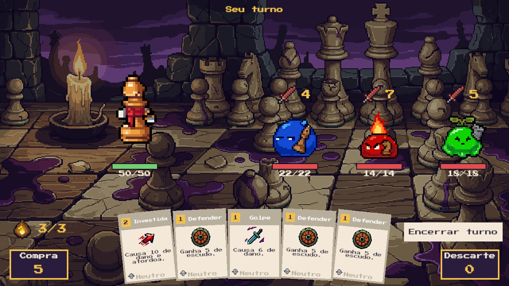

## 6. Elementos: o ciclo da tinta

As cartas e os inimigos têm elemento. O ataque de um elemento **forte** contra um elemento **fraco** causa **+50% de dano** e mostra **"Eficaz!"** em dourado.

| Ícone | Elemento | Vence | Perde para |
|---|---|---|---|
| 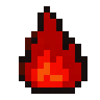 | **Fogo** | Planta | Água |
| 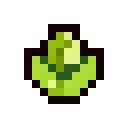 | **Planta** | Água | Fogo |
| 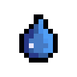 | **Água** | Fogo | Planta |
|  | **Neutro** | ninguém | ninguém |

**Fogo vence Planta, Planta vence Água, Água vence Fogo.** Como o Slime Verde, o Rei Slime e o Mirim são de Planta, **cartas de Fogo** (Bola de Fogo, Brasa) são suas melhores amigas contra a maioria dos inimigos. Contra o Slime Vermelho (Fogo), use Água; contra o Azul (Água), use Planta.

**Como o dano é calculado:** dano base da carta + sua Força → ×1,5 se for eficaz → ×0,75 se quem ataca estiver Fraco → arredonda para baixo → o **escudo** do alvo absorve primeiro, e o que sobrar tira vida.

## 7. Status

| Ícone | Status | O que faz |
|---|---|---|
| 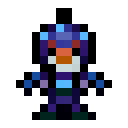 | **Escudo** | Absorve dano antes da vida. Zera no início do turno de quem o tem. |
| 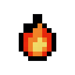 | **Queimadura (N)** | No início do turno do alvo, ele perde **2 de vida** (ignora o escudo). Dura N turnos; aplicar de novo soma turnos. |
| 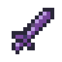 | **Fraco (N)** | Quem está Fraco causa **25% menos dano** por N turnos. |
| 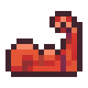 | **Força (N)** | **+N de dano** em cada ataque até o fim da batalha. |
| 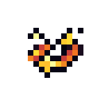 | **Atordoado** | **Pula a próxima ação**. O inimigo atordoado guarda a intenção para o turno seguinte. |

### Intenções dos inimigos

| Ícone | Intenção | Significa |
|---|---|---|
| 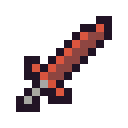 | **Ataque** | Vai causar dano (o número aparece ao lado) |
|  | **Defesa** | Vai ganhar escudo |
|  | **Buff** | Vai se fortalecer |
| 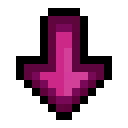 | **Debuff** | Vai aplicar um efeito ruim em você (por exemplo, Queimadura) |
|  | **Invocar** | Vai chamar reforços |

## 8. As cartas: ataques e skills

Cada carta mostra o **custo de energia**, o **nome**, a **ilustração**, o **efeito** e o **elemento** (a cor da moldura também indica: vermelho Fogo, verde Planta, azul Água, cinza Neutro). Uma carta **melhorada** (no Descanso ou pela Poça de Tinta) ganha um "+" no nome e valores maiores. Cartas com **Esgota** saem da batalha depois de usadas.

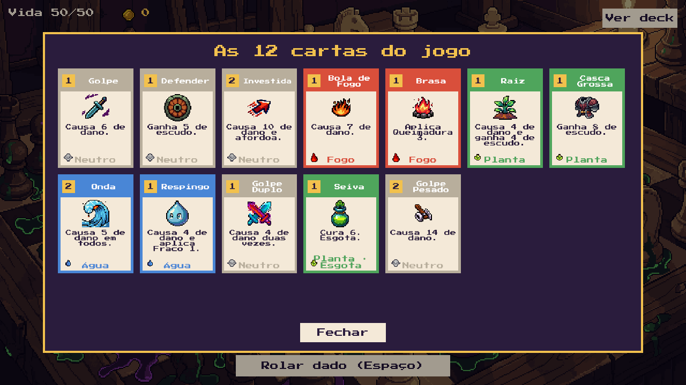

### Cartas iniciais

| Carta | Custo | Elemento | Efeito | Melhorada |
|---|---|---|---|---|
| 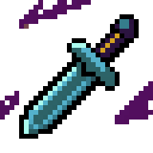 **Golpe** | 1 | Neutro | 6 de dano | 9 |
| 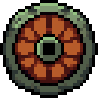 **Defender** | 1 | Neutro | 5 de escudo | 8 |
| 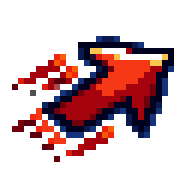 **Investida** | 2 | Neutro | 10 de dano e **Atordoa** o alvo | 14 |

### Cartas de recompensa (ataques e skills)

| Carta | Custo | Elemento | Tipo | Efeito | Melhorada |
|---|---|---|---|---|---|
| 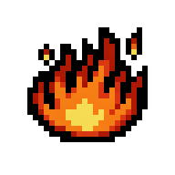 **Bola de Fogo** | 1 | Fogo | Ataque | 7 de dano | 10 |
| 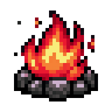 **Brasa** | 1 | Fogo | Skill | **Queimadura 3** | Queimadura 5 |
| 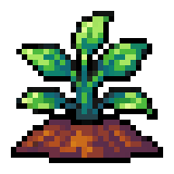 **Raiz** | 1 | Planta | Ataque + skill | 4 de dano **e** 4 de escudo | 6 e 6 |
| 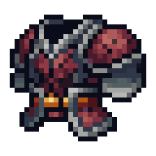 **Casca Grossa** | 1 | Planta | Skill | 8 de escudo | 11 |
| 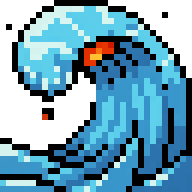 **Onda** | 2 | Água | Ataque em área | 5 de dano em **todos** os inimigos | 8 |
| 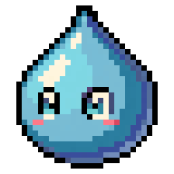 **Respingo** | 1 | Água | Ataque + skill | 4 de dano e **Fraco 1** | 6 e Fraco 2 |
| 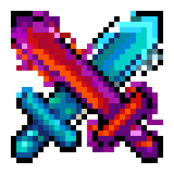 **Golpe Duplo** | 1 | Neutro | Ataque | 4 de dano **duas vezes** | 5 duas vezes |
| 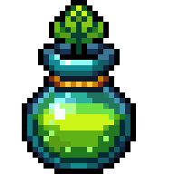 **Seiva** | 1 | Planta | Skill | **Cura 6**. Esgota | Cura 9 |
| 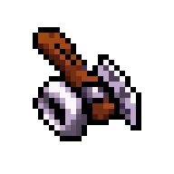 **Golpe Pesado** | 2 | Neutro | Ataque | 14 de dano | 18 |

**Combinações que valem a pena:** *Respingo* deixa um inimigo Fraco (−25% de dano) e ainda dá dano de Água; *Brasa* ataca ao longo do tempo e ignora escudo; *Investida* atordoa o inimigo mais perigoso e o faz perder o turno; *Onda* acaba com grupos de 3 slimes; *Golpe Duplo* é ótimo com a Força do Pincel Afiado, porque a Força soma em **cada** golpe.

## 9. As casas do tabuleiro

O tabuleiro tem **12 casas**, duas **bifurcações** (que voltam a se juntar) e o Chefe no fim.

| Casa | Ícone | O que acontece |
|---|---|---|
| **Início** | 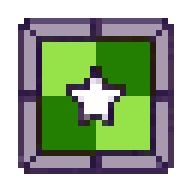 | Ponto de partida. Nada acontece. |
| **Batalha** (5) | 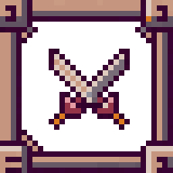 | De 1 a 3 slimes. Vencendo: 10 a 15 moedas e 1 carta à escolha. |
| **Loja** (1) | 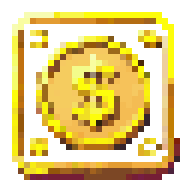 | Compre cartas, uma relíquia, cura ou remova cartas. |
| **Descanso** (1) | 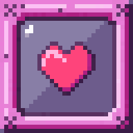 | Cure **30%** da vida máxima **ou** melhore 1 carta. |
| **Evento** (2) | 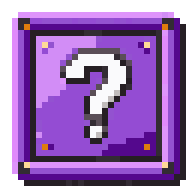 | Uma escolha com risco e recompensa (seção 12). |
| **Baú** (1) | 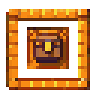 | 30 moedas e 1 relíquia aleatória. |
| **Chefe** (1) | 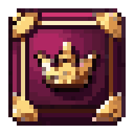 | O Rei Slime. O Peão sempre para aqui. |

### O dado

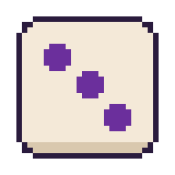

O dado do tabuleiro sorteia de **1 a 3**: assim o Peão para em mais casas e a partida tem mais batalhas, eventos e lojas. A **relíquia Dado Viciado** deixa você rolar de novo.

### Descanso

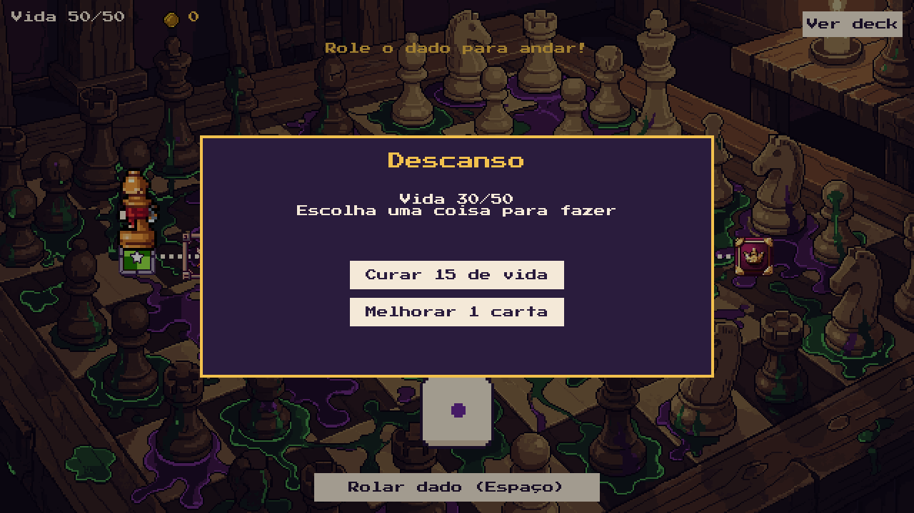

### Loja

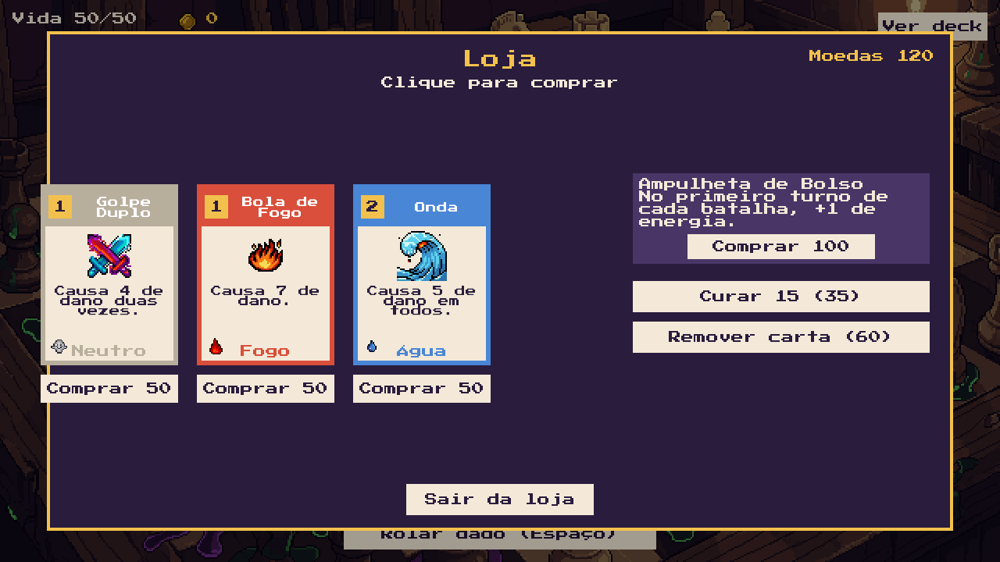

| Item | Preço |
|---|---|
| 3 cartas | 50 moedas cada |
| 1 relíquia | 100 moedas |
| Cura de 15 de vida | 35 moedas |
| Remover 1 carta do deck | 60 moedas |

Itens comprados somem da prateleira. Cura não vende com a vida cheia; remover carta não vende se o deck tiver só 1 carta.

### Baú

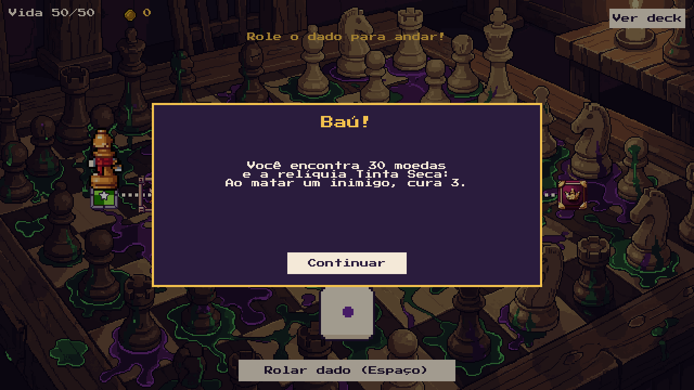

### Recompensa de batalha

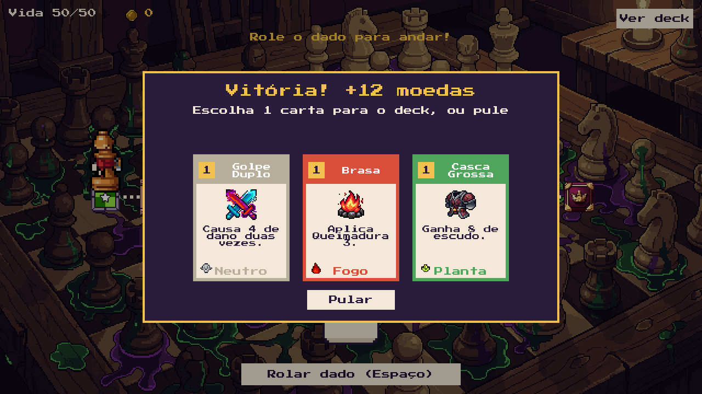

### Seu baralho

O botão **Ver deck** abre o painel com todas as suas cartas.

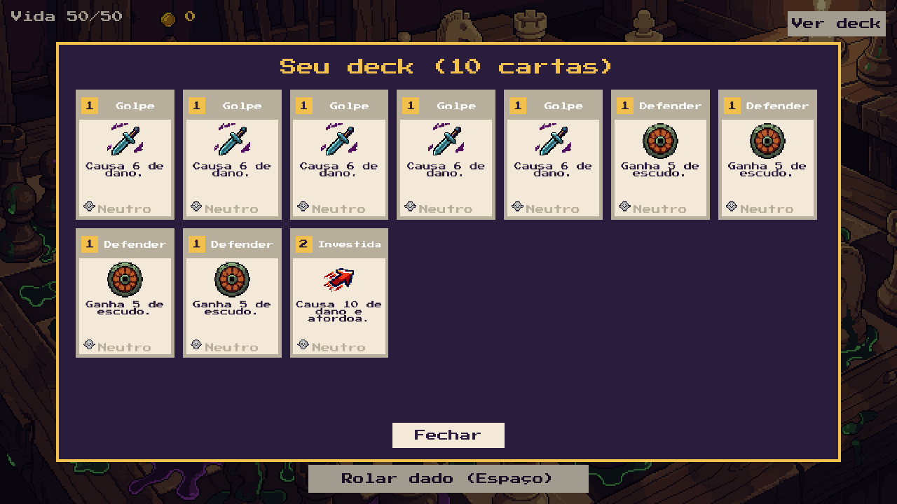

## 10. Relíquias

Relíquias são tesouros permanentes: valem até o fim da partida. Elas aparecem na barra do topo do tabuleiro (passe o mouse para ler a descrição). Você as ganha no **Baú**, na **Loja** e em eventos.

| Ícone | Relíquia | Efeito |
|---|---|---|
| 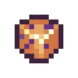 | **Dado Viciado** | Pode **rolar o dado de novo** (1 vez por rolagem). |
| 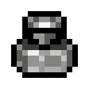 | **Base de Chumbo** | Começa toda batalha com **5 de escudo**. |
|  | **Tinta Seca** | Ao **matar um inimigo**, cura **3** de vida. |
|  | **Pincel Afiado** | Começa toda batalha com **1 de Força**. |
|  | **Ampulheta de Bolso** | No **primeiro turno** de cada batalha, **+1 de energia**. |

## 11. Moedas

 Ganhas depois de cada batalha (10 a 15) e no baú (30). Servem para comprar na loja. O contador fica no canto superior do tabuleiro, ao lado da vida.

## 12. Eventos

As duas casas de **Evento** sorteiam 2 dos 3 eventos abaixo, sem repetir. Cada um tem duas escolhas.

| Evento | Escolha A | Escolha B |
|---|---|---|
| **Poça de Tinta** | Beber: perde 6 de vida e ganha 1 carta aleatória **já melhorada** | Seguir em frente |
| **Dado Gigante** | Rolar 1d6: 1-2 perde 8 de vida; 3-4 ganha 30 moedas; 5-6 ganha 1 relíquia | Não rolar |
| **Fonte de Feltro** | Beber: cura 12 de vida | Remover 1 carta do deck |

Perder vida num evento **nunca mata**: no pior caso sobra 1 de vida.

## 13. Vitória e derrota

**Vitória:** derrote o Rei Slime. A tinta seca, o Peão comemora e aparece a tela de vitória com os créditos.

**Derrota:** se sua vida chegar a zero em **qualquer batalha**, a partida acaba. Você pode **Tentar de novo** (nova partida do zero) ou **Voltar ao título**. Não há save: cada partida começa do zero, e é isso que torna cada uma diferente.

### Pausa

Aperte **Esc** no tabuleiro ou na batalha.

## 14. Dicas

- **Leia as intenções.** Se o inimigo vai atacar com 7, vale mais gastar energia em escudo do que em dano.
- **Atordoe o que dói.** A *Investida* faz o inimigo perder a ação do turno. Use-a no que causa mais dano.
- **Explore o ciclo de elementos.** Um golpe eficaz vale +50%. Uma Bola de Fogo (7) em Planta causa 10.
- **Mate primeiro o Azul.** Ele cura os aliados e prolonga a luta; ataque-o antes se for seguro.
- **Cuidado com a Queimadura.** Ela ignora o escudo; contra o Vermelho, mantenha a vida alta.
- **No Chefe, fogo nos Mirins e no Rei.** Todos são de Planta. Brasa no Rei causa dano a cada turno sem você gastar mais energia.
- **O Rei se enfurece abaixo de 50%.** Termine a luta com escudo de sobra ou use Respingo (Fraco) para cortar o dano dele.
- **Descanso: cure ou melhore?** Melhorar a *Investida* ou o *Golpe Pesado* costuma render mais a longo prazo; cure se estiver abaixo de metade da vida.
- **Remova cartas fracas.** Menos cartas no baralho significa comprar as boas mais vezes (*Fonte de Feltro* ou Loja).
- **Aproveite o Baú e a Loja.** As bifurcações deixam você escolher: um lado tem Baú, o outro tem uma Batalha extra.

## 15. Créditos

**Design, programação e documentação:** Márcio Dias de Lima Filho e Tiago Augusto Dal'Acqua Gonçalves.
**Arte:** gerada no PixelLab e selecionada e ajustada pela equipe. **Sons e músicas:** sintetizados pela equipe (obra própria, CC0). **Fonte:** Press Start 2P (SIL Open Font License 1.1). **Motor:** Unity 6 · C#.
