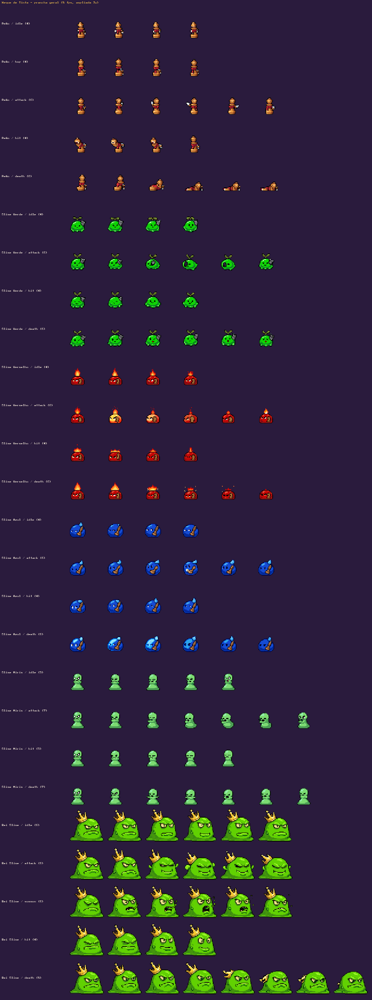
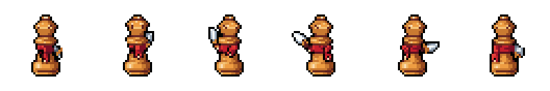
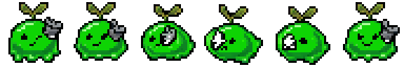
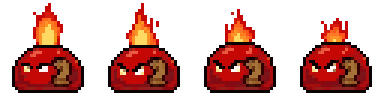
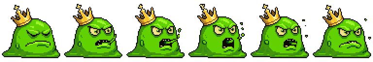
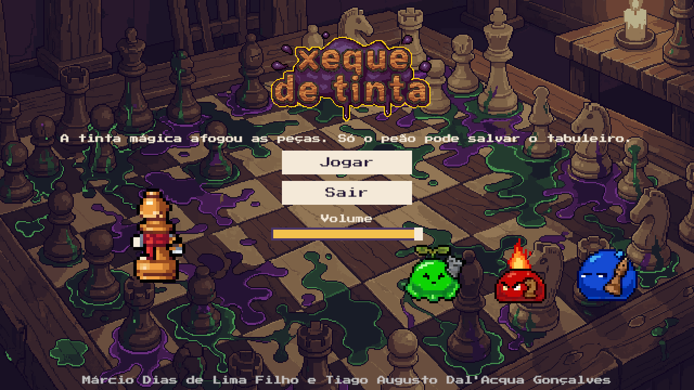
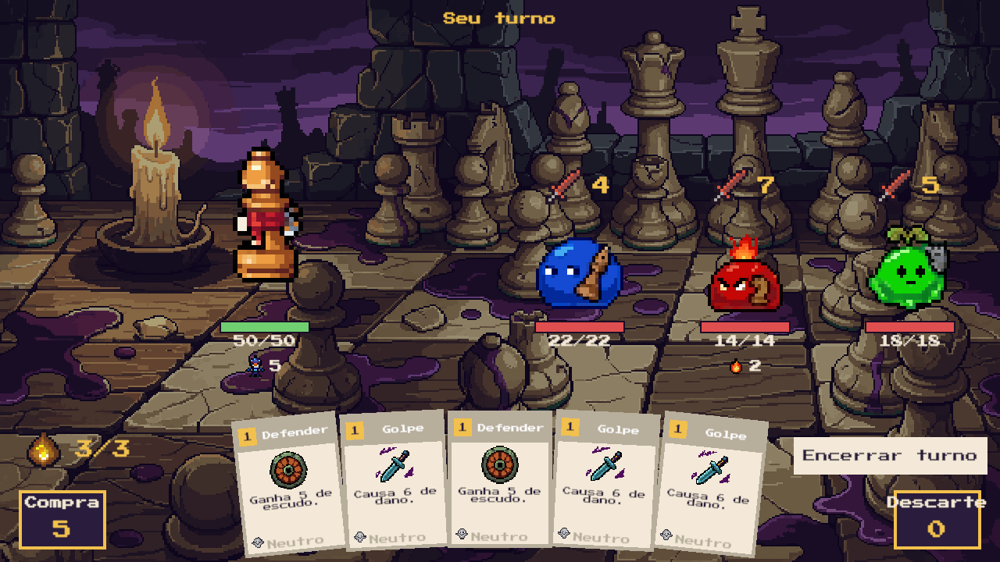

# Xeque de Tinta · 04 Design Visual

## 1. Estilo

Pixel art de **vista lateral** (herói virado para a direita, inimigos para a esquerda), **contorno escuro de 1 px**, sombreamento simples de 2 a 3 tons e **cores vivas** sobre fundo roxo escuro. O tema é um **tabuleiro de xadrez gigante de madeira, manchado de tinta mágica roxa e verde, à luz de uma vela**. Cada slime leva um detalhe do elemento (folha, chama ou gota) **e** uma peça de xadrez afundada: a cor e o elemento vêm primeiro, a peça é detalhe.

| Regra | Valor |
|---|---|
| Personagens e casas | 32x32 (o Peão tem quadro de 44x44 para a espada e o cachecol) |
| Chefe | 64x64 |
| Ícones | 16x16 (orbe de energia 20x20) |
| Fundos | 640x360 |
| Logo | 256x96 |
| Pixels Per Unit | 32 |
| Filtro / compressão | Point (sem filtro) / None, sem mipmaps |
| Câmera | Ortográfica fixa, **Pixel Perfect Camera**, referência 640x360 |
| Pivô | Centro inferior (personagens), centro (demais) |

A janela usa **zoom inteiro** (2x em 1280x720, 3x em 1920x1080); a interface usa o mesmo zoom (`CanvasMatch`), de modo que nada fica borrado.

## 2. Paleta

| Cor | Hex | Uso |
|---|---|---|
| Roxo escuro | `#2A1B3D` | Fundo, painéis |
| Roxo claro | `#4A3566` | Barras e detalhes de painel |
| Dourado | `#F2C14E` | Títulos, destaque, números "Eficaz!" e moedas |
| Creme | `#F4E9D8` | Texto, botões, fundo das cartas |
| Vermelho | `#E04F4F` | Dano, vida baixa |
| Verde | `#6FCF6F` | Cura, Força |
| Fogo (moldura de carta) | `#D9503A` | Elemento Fogo |
| Planta (moldura) | `#4FA55B` | Elemento Planta |
| Água (moldura) | `#4A86D6` | Elemento Água |
| Neutro (moldura) | `#B8AE9C` | Elemento Neutro |
| Casa resolvida | cinza `#6B6B7A` (tinta 0,42/0,42/0,48) | Casa já visitada no tabuleiro |

A **moldura das cartas** é um único desenho tingido por código com a cor do elemento. A fonte é **Press Start 2P** (SIL OFL 1.1).

## 3. Lista de sprite sheets (pasta `Sprites/` da entrega)

Uma sprite sheet PNG por personagem e animação (quadros em linha, mesmo tamanho, fundo transparente) e um `.json` com o tamanho do quadro, a quantidade e o fps. A **prancha geral** com todas as animações é `Sprites/prancha_geral.png`.

| Pasta | Arquivos | Quadro |
|---|---|---|
| `Personagens/` | `pawn_idle`, `pawn_hop`, `pawn_attack`, `pawn_hit`, `pawn_death` | 44x44 |
| `Inimigos/` | `slime_green_*`, `slime_red_*`, `slime_blue_*`, `ink_pawn_*` (idle, attack, hit, death) | 32x32 |
| `Chefe/` | `king_slime_idle`, `_attack`, `_summon`, `_hit`, `_death` | 64x64 |
| `Tabuleiro/` | `tiles` (7 casas), `dice_faces` (6 faces) | 32x32 |
| `Interface/` | `intents` (5), `status` (5), `elements` (4), `coin`, `energy_orb`, `logo` | 16, 20 e 256x96 |
| `Cartas/` | `card_art` (12 ilustrações) | 32x32 |
| `Reliquias/` | `relics` (5 ícones) | 16x16 |
| `Fundos/` | `bg_board`, `bg_battle` | 640x360 |

## 4. Animações de cada personagem

Todas rodam a **8 quadros por segundo**; só `idle` repete. Os clipes e os Animator Controllers são gerados por `ArtPipeline`.

| Personagem | idle | hop | attack | summon | hit | death |
|---|---|---|---|---|---|---|
| **Peão** (44x44) | 4 | 4 | 6 | : | 4 | 6 |
| **Slime Verde** (32) | 4 | : | 6 | : | 4 | 6 |
| **Slime Vermelho** (32) | 4 | : | 6 | : | 4 | 6 |
| **Slime Azul** (32) | 4 | : | 6 | : | 4 | 6 |
| **Slime Mirim / peão de tinta** (32) | 5 | : | 7 | : | 5 | 7 |
| **Rei Slime** (64) | 6 | : | 6 | 6 | 4 | 8 |

Uso de cada animação:

| Animação | Quando toca |
|---|---|
| `idle` | Parado, em repouso (tabuleiro, batalha, título) |
| `hop` | O Peão pula de uma casa para outra no tabuleiro |
| `attack` | O personagem ataca; no **quadro 4 (índice 3)** um Animation Event `OnImpact` aplica o dano |
| `summon` | O Rei Slime usa **Dividir** e invoca os Mirins |
| `hit` | O alvo recebe dano (disparada no impacto) |
| `death` | A vida chega a zero; no último quadro o Animation Event `OnDeathEnd` desfaz o sprite em fade |

Exemplos (ampliados 3x):

## 5. Efeitos visuais e de tela

Os efeitos são feitos **por código**, sem sprite extra:

| Efeito | Como é feito |
|---|---|
| **Números de dano flutuantes** | Texto TMP sobe e some; dourado para dano eficaz, vermelho para dano normal, laranja para Queimadura, azul para "Bloqueado" e "+N Esc", verde para cura |
| **"Eficaz!"** | Texto dourado extra sobre o alvo quando o ataque tem vantagem elemental |
| **Flash do alvo** | O sprite pisca em vermelho (herói) ou branco (inimigo) ao apanhar |
| **Tremor de tela** | Câmera sacode em passos de 1 pixel, intensidade proporcional ao dano no herói; leve em golpes eficazes e mortes |
| **Fade preto entre cenas** | `ScreenFader`, cerca de 0,25 s |
| **Dado rolando** | Faces alternadas com tremor e número grande ao parar |
| **Casas resolvidas** | Mesmo sprite escurecido e dessaturado (cinza) |
| **Carta em foco** | Aumenta e sobe ao passar o mouse; carta esperando alvo sobe um pouco |
| **Intenções e status** | Ícones de 16 px sobre os inimigos e abaixo da barra de vida |
| **Morte dos slimes** | A animação `death` se desfaz em tinta e depois some em fade |

## 6. Interface

Título (logo, Jogar, Sair, volume), tabuleiro (vida, moedas, relíquias, Ver deck, dado), batalha (barras de vida, energia, mão de cartas em leque, pilhas de Compra e Descarte, Encerrar turno), painéis (recompensa, loja, descanso, evento, baú, deck), pausa e telas de fim. Tudo ancorado num **quadro de 640x360** centralizado, para o HUD não encostar nas bordas em janelas largas.

## 7. Como a arte foi produzida (de forma transparente)

- **Geração:** toda a arte de personagens, inimigos, chefe, cartas, relíquias, ícones, casas e fundos foi **gerada com IA no PixelLab** (serviço de geração de pixel art, via MCP), a partir de prompts em inglês baseados em: `pixel art, side view, dark 1px outline, vivid saturated colors, simple 3-tone shading, transparent background, board game piece made of [material]`. O prompt de cada item está no `ASSETS.md`.
- **Seleção e ajustes pela equipe:** para os personagens, geramos candidatos e **escolhemos a variação** que melhor segue as regras de estilo (silhueta legível em 32 px, contorno, paleta, vista lateral, direção correta); as rejeitadas ficam em `Art/_Rejected/` (48 arquivos) para poderem ser trocadas. O Peão escolhido foi a **âncora de estilo** dos demais pedidos. Os slimes foram gerados como objetos (`create_1_direction_object`, 64 candidatos por pedido, escolhidos à mão) e animados (`animate_object`), porque o modo de personagem só desenha humanoides.
- **Refações por qualidade:** o Slime Mirim foi refeito com rosto (o primeiro parecia de costas); as ilustrações de 6 cartas foram refeitas como "ícones de item"; os fundos foram **escurecidos por código** (batalha 58%, tabuleiro 48%) para os personagens se destacarem.
- **Feito por código, sem IA:** as 6 faces do dado (quadrados chapados, `DiceFaceBuilder`), a moldura das cartas (tingida por elemento), painéis e botões, o brilho/cinza das casas e todos os efeitos de tela.
- **Importação:** `ArtPipeline` aplica as regras de pixel art (PPU 32, Point, sem compressão) e monta clipes e Animators.
- **Mudança de tema:** o jogo nasceu com tema de floresta e foi **regerado** para o tabuleiro de xadrez (fundos, Rei Slime, 3 slimes e peão de tinta; 83 gerações). As versões antigas ficam em `Art/_Rejected/floresta/`.
- **Custo:** o PixelLab informou saldo 2000 → 1792 de gerações ao fim da regeração do tema (lote 1: 73; lote 2: 52; peão de tinta: 24; tema: 83).
- **Fora do jogo:** `Art/_Reference` (sprites antigos de estilo) e `Art/_Rejected` não entram na build nem na entrega.
